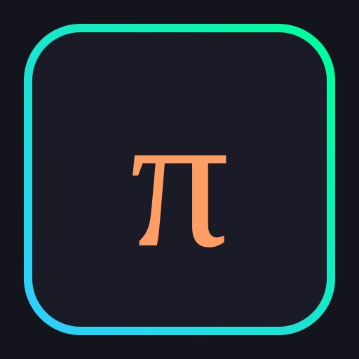
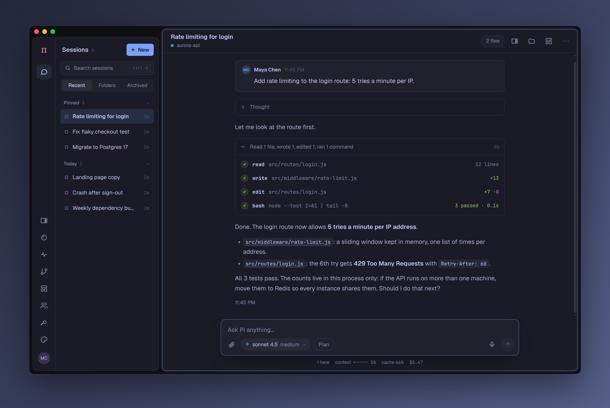
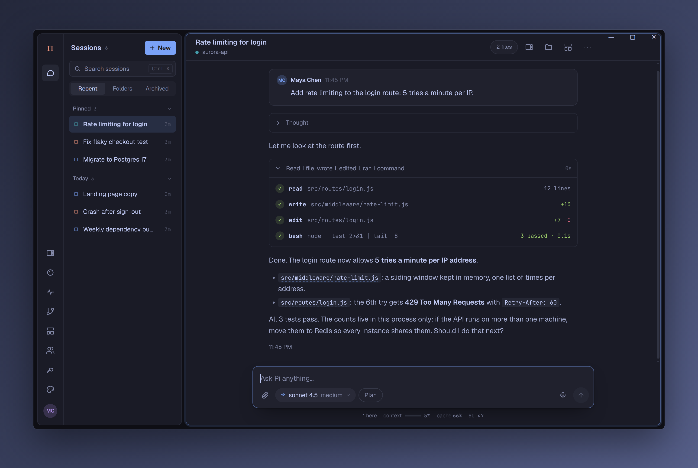
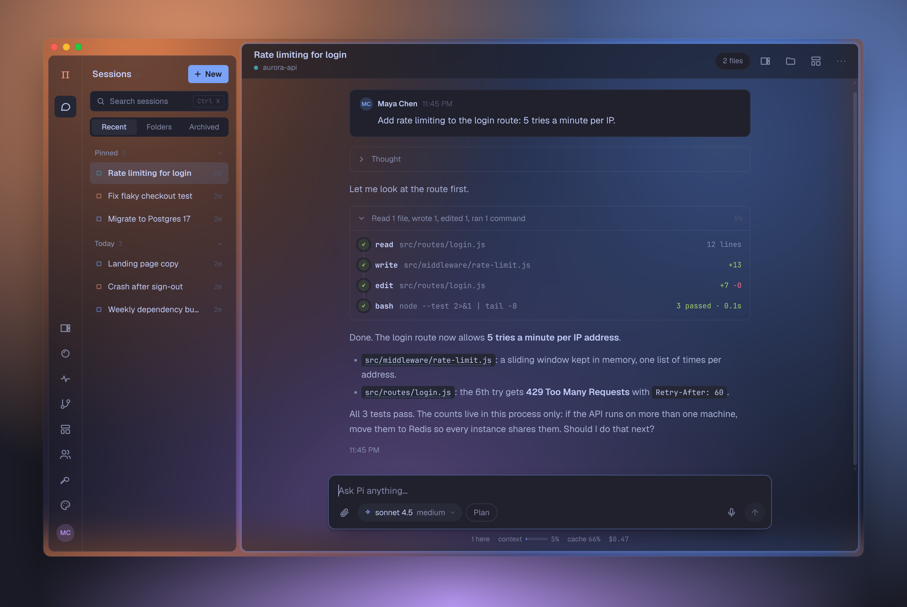
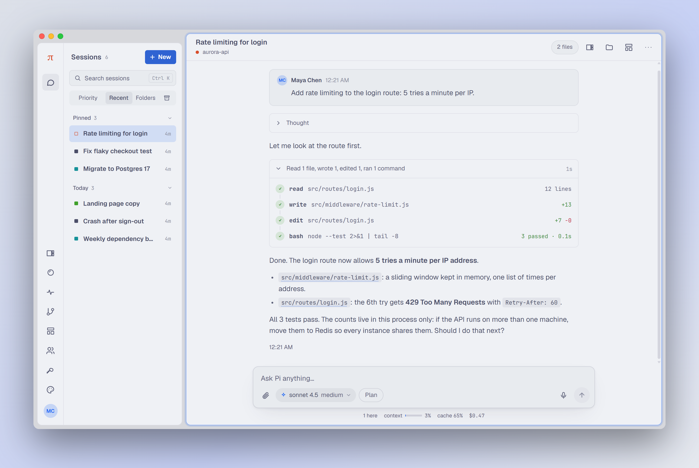
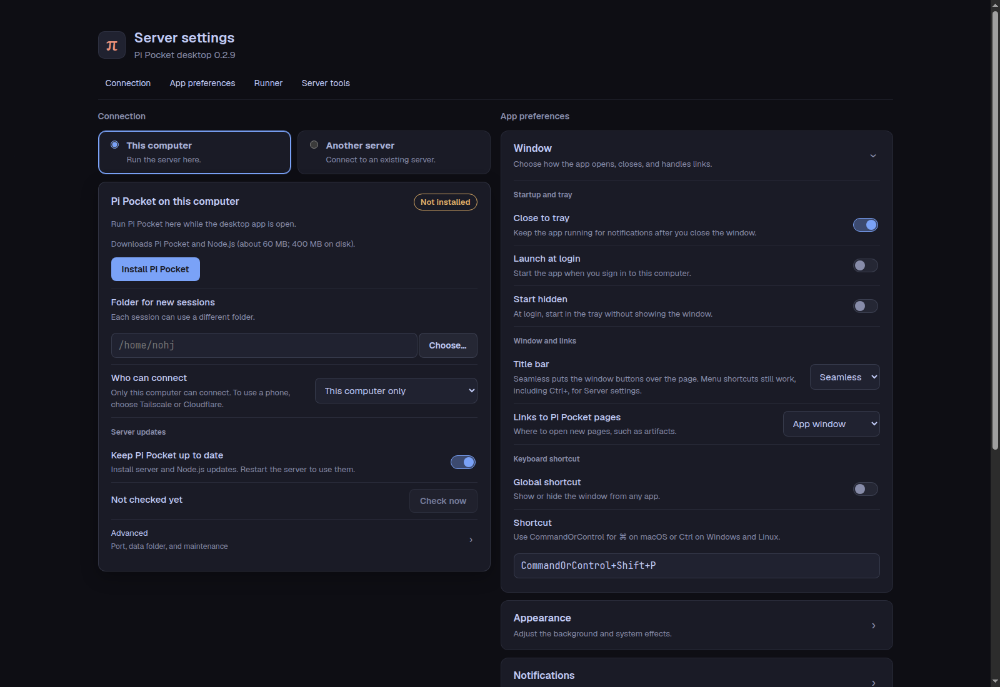

<div align="center">



# Pi Pocket for desktop

**Your [Pi Pocket](https://github.com/TannerMidd/pi-pocket) server, as a real app on macOS, Windows, and Linux.**

A tray with your pinned sessions · a badge · native notifications · a seamless window · a see-through background

[Download](https://github.com/vitalNohj/pi-pocket-gui/releases/latest) · [Install](#install) · [Settings](#settings) · [Roadmap](#roadmap)



</div>

> [!NOTE]
> **Remote execution is still being worked on.** Pi works on the files and runs the commands of the computer the server is on. With a server on this computer, that is this computer. With a server elsewhere (a home server, a VPS), it is that machine, not this one: working on this computer's files from a remote server needs remote execution, which is not in the app yet.

## What it is

The app opens the Pi Pocket you already run (on this computer, on a home server, or behind a tunnel) in a window of its own, and adds what a browser tab cannot do. It runs no server and no model itself: your sessions, keys, and history stay on the server.

|  |  |
|---|---|
| **Tray** | Your pinned sessions with their state (◆ waiting for you, ◐ working, ✕ failed), one click away. |
| **Badge** | How many sessions need you, on the dock or taskbar icon. |
| **Notifications** | Native ones, even with the window hidden. An approval can be answered from the notification. |
| **Seamless window** | No title bar: Pi Pocket runs to the top edge, and the window's buttons sit over it. |
| **See-through background** | The desktop shows through Pi Pocket's background, blurred, as much as you choose. |
| **Your theme** | The settings screen, the window, and the tray's π follow the theme Pi Pocket shows. |
| **Global shortcut** | Show or hide the window from anywhere. |
| **Launch at login** | Optionally hidden in the tray, so notifications keep coming. |
| **Updates** | It checks for new releases and installs them (or downloads them, on macOS). |

## Install

You need a Pi Pocket server first. On any computer with Node.js 22.19 or newer:

```bash
npm install -g pi-pocket && pi-pocket
```

Then download the app for your computer from [**Releases**](https://github.com/vitalNohj/pi-pocket-gui/releases/latest):

| | File | |
|---|---|---|
| **macOS** | `…-mac-arm64.dmg` (Apple Silicon) or `…-mac-x64.dmg` (Intel) | Drag the app into Applications. It is not signed by Apple yet: the first time, right-click it and choose **Open**. If macOS still refuses, use **Open Anyway** in System Settings → Privacy & Security, or run `xattr -cr "/Applications/Pi Pocket.app"`. |
| **Windows** | `…-win-x64.exe` | SmartScreen warns about an unsigned app: **More info** → **Run anyway**. |
| **Linux** | `…-linux-x86_64.AppImage` or `…-linux-amd64.deb` | Make the AppImage executable and run it, or install the .deb. |

Open the app, give it your server's address (`http://127.0.0.1:8787` by default), and sign in inside Pi Pocket with your login link or an invite.

> Version 0.1.0 was named `pi-pocket-gui.app` on macOS. After installing a newer one, move the old one to the Trash.

## A closer look

### A window without a title bar

Pi Pocket runs to the window's top edge, and only what sits under the window's buttons makes room for them: on macOS the sidebar starts a little lower and the conversation keeps its whole height. On Windows and Linux the buttons sit at the top right instead.



The app tells the page where the buttons are through the [Window Controls Overlay](https://developer.mozilla.org/en-US/docs/Web/API/Window_Controls_Overlay_API), the web's own standard for it. An older Pi Pocket gets a plain band as tall as the buttons. Drag the window by the bar beside them. Settings → Window → Title bar → **The system's** brings back the normal title bar, after a restart.

### See-through background

Turn on **See-through background** in Settings → Appearance, and set the **Opacity** from 0% to 100%. Menus, sheets, and cards stay solid, so text stays readable.



- **macOS:** the system's blur (vibrancy). **Blur** picks its material.
- **Windows 11 (22H2 or newer):** Acrylic or Mica. Windows 10 cannot.
- **Linux:** turning it on takes a restart (the settings screen offers one). Your compositor does the blur: on Hyprland, `decoration:blur`; on KDE, the Blur effect. GNOME shows it see-through, without blur.

### It follows your theme

Change the theme in Pi Pocket and the app follows: the settings screen, the window's own background, and the tray's π. It remembers the colors, so the next start looks right before the server answers.



### Settings

Everything is on one screen: **Server settings…** in the File menu, the tray, Pi Pocket's own menu, or Ctrl+, (⌘, on macOS). The badge says **Connected** once Pi Pocket is open; **Connect** waits until you change the address and check the new one.



The settings are also a JSON file you can edit by hand. A value that is not valid falls back to its default, and the settings screen lists it.

| | |
|---|---|
| Linux | `~/.config/pi-pocket-gui/config.json` |
| macOS | `~/Library/Application Support/pi-pocket-gui/config.json` |
| Windows | `%APPDATA%\pi-pocket-gui\config.json` |

### Updates

The app looks for a new release at start and every 6 hours (Settings → Updates → **Check now**).

- **Windows and the AppImage** download it and install it when the app restarts. The app asks first.
- **macOS:** until the app is signed by Apple, macOS will not let it replace itself. It downloads the new disk image to Downloads, checked against GitHub's checksum, and opens it: drag the app into Applications over the old one. Your settings and sign-in stay.
- **The .deb** opens the release page: install the new .deb the same way.

## How it talks to Pi Pocket

Pi Pocket's page runs in the app as it does in a browser, with one addition: a small, versioned bridge (`window.pocketHost`) through which the page tells the app about pins, the badge, and notifications, and the app tells the page when its window is hidden. The bridge is on a branch of Pi Pocket and not yet in a release: against a Pi Pocket without it, the app still works, without the tray pins, badge, and notifications, and says so once.

## Roadmap

Being worked on, none of it in the app yet:

- **Remote execution:** sessions on your server whose files and commands are on this computer.
- **New session from anywhere:** ⌘N / Ctrl+N, the dock's or taskbar's menu, and a `pi-pocket://new` link.
- **Offline dictation:** speech to text on this computer, for Pi Pocket's microphone button.
- **Signed builds** for macOS and Windows, so updates install themselves everywhere.

## Develop

```bash
npm install
npm start      # build and run
npm test       # unit tests
npm run dist:linux
```

`PI_POCKET_GUI_USER_DATA=/tmp/gui-data npm start` runs with a separate settings folder.

A push to `main` builds every platform on GitHub Actions (the run's artifacts). A tag publishes a release, which the app's updater reads:

```bash
npm version patch   # bumps package.json and tags vX.Y.Z
git push --follow-tags
```

The screenshots above come from the app itself, run against a Pi Pocket with made-up people and sessions ([scripts/screenshots/](scripts/screenshots/)).

## License

MIT. Pi Pocket's icon is MIT too ([assets/NOTICE.md](assets/NOTICE.md)).
